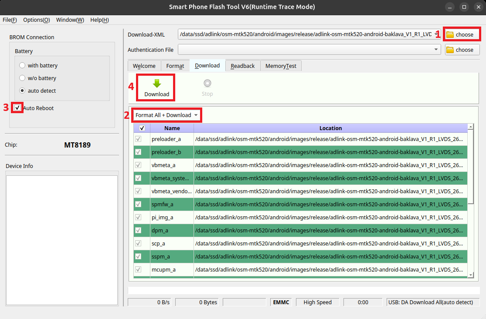
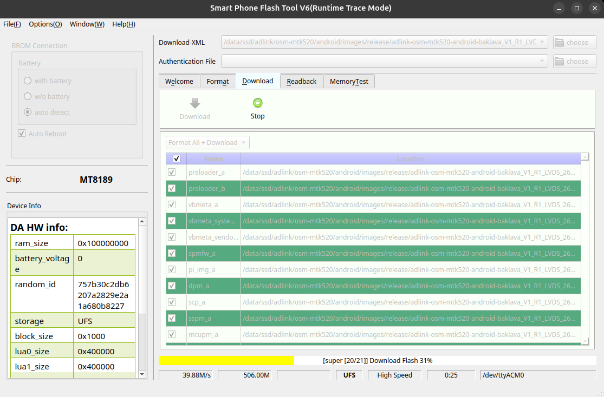
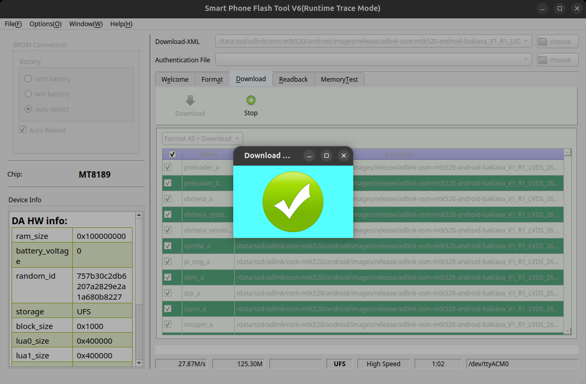

# Android 16 for ADLINK OSM-MTK520

## Contents
```
1. Hardware Details
2. Software Details
3. Package structure
4. Flashing the image and booting
   4.1. Host Preparation & SP Flash Tool Setup
   4.2. Flashing Android Image
5. Peripheral testing
   5.1. GPIO
   5.2. SD Card
   5.3. I2C
   5.4. SPI
   5.5. USB
   5.6. DisplayPort (DP)
   5.7. MIPI DSI Display
   5.8. LVDS Display
   5.9. Audio - TLV320 Audio Codec
   5.10. MIPI CSI Camera
   5.11. PWM
   5.12. UART - Console
   5.13. UART - Serial Ports
   5.14. Ethernet
   5.15. Wi-Fi
   5.16. Bluetooth
   5.17. PCIe / NVMe
   5.18. RTC
   5.19. ADC
```

## 1 Hardware Details

| Item | Details |
|:------------------|:----------------------|
| **Module**        | **OSM-520**           |
| **Carrier**       | **EB4**               |
| **Board Version** | **OSM-520: A1, EB4: A1** |

## 2 Software Details

|   Android   |   Ver 16    |
|:-----------:|:-----------:|
| **Kernel**  | **6.1.145** |


## 3 Package structure

```
|---adlink-osm-mtk520-android-baklava_V1_R1_<feature>_261105
    |--- android images
    |--- README.md
```
Depending on the required display interface, download and extract the corresponding Android release package:
* **DisplayPort (DP)**: `adlink-osm-mtk520-android-baklava_V1_R1_DP_261105.zip`
* **MIPI DSI**: `adlink-osm-mtk520-android-baklava_V1_R1_DSI_261105.zip`
* **LVDS**: `adlink-osm-mtk520-android-baklava_V1_R1_LVDS_261105.zip`


## 4 Flashing the Image and Booting

### 4.1 Host Preparation & SP Flash Tool Setup
* Follow instructions on the MediaTek website to prepare the Host PC (Linux) for the flashing process (setting up udev USB device rules):
  https://genio.mediatek.com/doc/iot-yocto/latest/sw/yocto/get-started/env-setup/flash-env-linux.html#usb-device-rules

* Download `SP_Flash_Tool_Selector_exe_Linux_v1.2444.00.100.tar.xz` from ADLINK.
* Extract the archive and launch **SPFlashToolV6**:
  ```shell
  $ tar -xJvf SP_Flash_Tool_Selector_exe_Linux_v1.2444.00.100.tar.xz
  $ cd SP_Flash_Tool_Selector_exe_Linux_v1.2444.00.100/SP_Flash_Tool_V6
  $ ./SPFlashToolV6
  ```

### 4.2 Flashing Android Image
1. Click **"choose"** and pick the `flash.xml` file from:
   `<extracted_android_image>/download_agent/flash.xml`
2. Select **"Format All + Download"** in the flashing option dropdown.
3. Check **"Auto Reboot"** to allow the board to automatically boot the flashed image after completion.
4. Click **"Download"** to start the flashing process.



5. Now power on the board with the Micro USB port connected to the Host PC using a compatible cable.
   The tool should detect the board and start downloading the images to the board.



6. Wait for the flashing process to complete.



The board will automatically reboot and boot the downloaded Android image.


## 5 Peripheral testing

### 5.1 GPIO

GPIO pins on the expansion header can be controlled and monitored using `libgpiod` utilities (`gpioset` and `gpioget`).

The GPIO mapping is as follows:

| Kernel Number | GPIO Header Number |
|:-------------:|:------------------:|
| 7             | CN2901-7           |
| 9             | CN2901-11          |
| 10            | CN2901-13          |
| 11            | CN2901-15          |
| 12            | CN2901-12          |
| 13            | CN2901-16          |
| 14            | CN2901-18          |
| 15            | CN2904-2           |

*(Note: **CN2901-7** (Kernel number 7) is demonstrated as an example below; the same procedure can be used to test all other GPIO pins by substituting the respective kernel number).*

#### Write Test
Execute the write command from root `adb shell` and read/measure the output voltage on the pin with a multimeter after each command:

* Drive GPIO Low:
  ```shell
  $ gpioset gpiochip1 7=0
  ```
  Measure the voltage on pin **CN2901-7**; it should read **0V** (Low).

* Drive GPIO High:
  ```shell
  $ gpioset gpiochip1 7=1
  ```
  Measure the voltage on pin **CN2901-7**; it should read **High** (logic level voltage).

#### Read Test
Feed an input voltage signal to the pin and confirm the value read back:

* Feed Low input (connect **CN2901-7** to **GND**):
  ```shell
  $ gpioget gpiochip1 7
  ```
  Confirm the output reads `0`.

* Feed High input (connect **CN2901-7** to logic **High** (3.3V)):
  ```shell
  $ gpioget gpiochip1 7
  ```
  Confirm the output reads `1`.


### 5.2 SD Card

* Insert a formatted Micro SD card (FAT32/exFAT) into the SD card slot.
* Verify SD card detection from root `adb shell`:
  ```shell
  $ adb root
  $ adb shell
  # dmesg | grep -i mmc1
  ```
  Expected output:
  ```
  [ 3.291497] mmc1: host does not support reading read-only switch, assuming write-enable
  [ 3.299456] mmc1: new ultra high speed SDR104 SDHC card at address aaaa
  [ 3.301225] mmcblk1: mmc1:aaaa SK32G 29.7 GiB
  [ 6.574121] vold: Found disk at /devices/platform/soc/11240000.mmc/mmc_host/mmc1/mmc1:aaaa/block/mmcblk1 but delaying scan due to secure keyguard
  ```


### 5.3 I2C

I2C buses can be scanned using `i2c-tools`.

* List available I2C adapters:
  ```shell
  $ i2cdetect -l
  ```
* Detect devices on a specific I2C bus:
  ```shell
  $ i2cdetect -y <busnum>
  ```


### 5.4 SPI

Two instances of SPI (`spidev0.0` and `spidev1.0`) are available for user applications and can be validated using the `spidevtest` utility in loopback mode.

#### 5.4.1 SPI0 (`/dev/spidev0.0`) Loopback Test
* **Pin Connection**: Connect MOSI and MISO pins together:
  - MOSI: **CN2902-4**
  - MISO: **CN2902-6**

* Run `spidevtest` from `adb shell`:
  ```shell
  $ spidevtest -D /dev/spidev0.0 -p "12345" -v
  ```
  Expected output:
  ```
  spi mode: 0x0
  bits per word: 8
  max speed: 500000 Hz (500 kHz)
  TX | 31 32 33 34 35 __ __ __ __ __ __ __ __ __ __ __ __ __ __ __ __ __ __ __ __ __ __ __ __ __ __ __ |12345|
  RX | 31 32 33 34 35 __ __ __ __ __ __ __ __ __ __ __ __ __ __ __ __ __ __ __ __ __ __ __ __ __ __ __ |12345|
  ```

#### 5.4.2 SPI1 (`/dev/spidev1.0`) Loopback Test
* **Pin Connection**: Connect MOSI and MISO pins together:
  - MOSI: **CN2901-19**
  - MISO: **CN2904-1**

* Run `spidevtest` from `adb shell`:
  ```shell
  $ spidevtest -D /dev/spidev1.0 -p "12345" -v
  ```
  Expected output:
  ```
  spi mode: 0x0
  bits per word: 8
  max speed: 500000 Hz (500 kHz)
  TX | 31 32 33 34 35 __ __ __ __ __ __ __ __ __ __ __ __ __ __ __ __ __ __ __ __ __ __ __ __ __ __ __ |12345|
  RX | 31 32 33 34 35 __ __ __ __ __ __ __ __ __ __ __ __ __ __ __ __ __ __ __ __ __ __ __ __ __ __ __ |12345|
  ```


### 5.5 USB

The board features four USB Type-A host ports and one Micro USB port for ADB connection.

#### 5.5.1 USB Host Ports (4x Type-A)
* The four USB Type-A host ports can be validated by connecting appropriate USB devices such as a USB keyboard, mouse, or USB storage device (flash drive).
* USB devices can be operated from the Android GUI, and connected storage devices will be accessible in the file manager.
* Verify USB device enumeration from `adb shell`:
  ```shell
  $ lsusb
  ```

#### 5.5.2 Micro USB Port (Device Mode - ADB)
* Connect a Micro USB cable between the board's Micro USB port and the host PC.
* Verify the ADB connection from the host terminal:
  ```shell
  $ adb devices
  $ adb shell
  ```


### 5.6 DisplayPort (DP)

* Use the DP release image: `adlink-osm-mtk520-android-baklava_V1_R1_DP_261105.zip`.
* Connect a DisplayPort monitor to the DP connector before powering on the board. The DP display must be connected when Android boots.
* Power on the board and verify that the Android UI (boot animation followed by the Home screen) displays properly on the DP monitor.
* *(Note: Android will reboot if it does not detect any connected display device during boot, which is expected behavior).*


### 5.7 MIPI DSI Display

* Use the DSI release image: `adlink-osm-mtk520-android-baklava_V1_R1_DSI_261105.zip`.
* Connect the MIPI DSI display panel to the DSI connector before powering on the board.
* The supported MIPI DSI panel resolution is **1920x1200**.
* Power on the board and verify that the Android UI (boot animation and Home screen) renders properly on the DSI panel at 1920x1200 resolution.
* *(Note: The MIPI DSI feature is supported but is yet to be tested)*.


### 5.8 LVDS Display

* Use the LVDS release image: `adlink-osm-mtk520-android-baklava_V1_R1_LVDS_261105.zip`.
* Connect the LVDS display panel and backlight cable to the LVDS interface before powering on the board.
* The supported LVDS panel resolution is **1280x800**.
* Power on the board and verify video output, backlight, and that the Android UI renders properly at 1280x800 resolution. *(Note: The panel does not have touch support).*


### 5.9 Audio - TLV320 Audio Codec

Audio playback and capture can be validated using the TLV320 audio codec via `tinyalsa` utilities.

From `adb shell`:

#### 1. Audio Capture (Recording)
Execute `tinycap` to record audio:
```shell
$ tinycap /data/local/tmp/test.wav -d 15 -r 48000 -c 2 -b 16 -t 5
```

#### 2. Audio Playback
Play back the recorded audio file using `tinyplay`:
```shell
$ tinyplay /data/local/tmp/test.wav
```


### 5.10 MIPI CSI Camera

* Android supports the D8 camera module on the MIPI CSI interface.
* Connect the D8 camera module to the CSI connector before powering on the board.
* The camera can be tested using the default Android **Camera** application.
* *(Note: The feature is supported and is yet to be tested).*


### 5.11 PWM

PWM channels can be tested via the Linux sysfs interface under `/sys/class/pwm/pwmchip0`.

#### PWM Pin Mapping:
| PWM Channel | Header Pin |
|:-----------:|:----------:|
| pwm1        | CN2904-9   |
| pwm2        | CN2904-11  |

#### 5.11.1 PWM1 Testing
From root `adb shell`:
```shell
$ adb root
$ adb shell
# cd /sys/class/pwm/pwmchip0
# echo 1 > export
# cd pwm1
# echo 2000000 > period        # 2 ms period (500 Hz)
# echo 1000000 > duty_cycle     # 1 ms duty cycle (50%)
# echo 1 > enable              # Enable PWM output
# echo 0 > enable              # Disable PWM output
```
To configure for 1 kHz frequency (1 ms period, 50% duty cycle):
```shell
# echo 1000000 > period
# echo 500000 > duty_cycle
# echo 1 > enable
# echo 0 > enable
```

#### 5.11.2 PWM2 Testing
From root `adb shell`:
```shell
# cd /sys/class/pwm/pwmchip0
# echo 2 > export
# cd pwm2
# echo 1000000 > period        # 1 ms period (1 kHz)
# echo 500000 > duty_cycle     # 0.5 ms duty cycle (50%)
# echo 1 > enable              # Enable PWM output
# echo 0 > enable              # Disable PWM output
```


### 5.12 UART - Console

* Connect a USB Type-C cable between the Host PC and the Type-C connector (**CN703**) on the carrier board to get Android boot and console logs.
* Open a terminal console on the Host PC (e.g., using `minicom` or `picocom`) configured with:
  - Baud rate: **921600**
  - Data bits: **8**
  - Parity: **None** (N)
  - Stop bits: **1**
  - Hardware Flow Control: **None** (921600 8-N-1)
* Power on the board to monitor bootloader and Android kernel console logs.


### 5.13 UART - Serial Ports

Two serial ports, **UARTC** (`/dev/ttyS1`) and **UARTD** (`/dev/ttyS3`), are available on the expansion connectors.

#### Pin Connections:

* **UARTC (CN2901)**:

| Pin | Function |
|:---:|:--------:|
| 8   | UART TX  |
| 10  | UART RX  |

* **UARTD (CN2904)**:

| Pin | Function |
|:---:|:--------:|
| 15  | UART TX  |
| 17  | UART RX  |

#### Serial Port Configuration
Configure the serial ports from root `adb shell`:
```shell
$ adb root
$ adb shell
# stty -F /dev/ttyS1 speed 115200 -echo
# stty -F /dev/ttyS3 speed 115200 -echo
```

#### Loopback / Communication Test between UARTC and UARTD:
1. Connect signals between CN2901 and CN2904:
   - Connect UARTC TX (**CN2901-8**) to UARTD RX (**CN2904-17**)
   - Connect UARTD TX (**CN2904-15**) to UARTC RX (**CN2901-10**)

2. Start listening on UARTD in the background:
   ```shell
   # cat /dev/ttyS3 &
   ```

3. Send data from UARTC:
   ```shell
   # echo 'ADLINK' > /dev/ttyS1
   ```
   `'ADLINK'` will be received and displayed on `/dev/ttyS3`.

4. Similarly, test the reverse path:
   ```shell
   # cat /dev/ttyS1 &
   # echo 'ADLINK' > /dev/ttyS3
   ```


### 5.14 Ethernet

The board supports two Ethernet ports:
* **ETH0**: Driver `dwmac-mediatek`
* **ETH1**: Driver `lan78xx`

#### Checking Interface Status
Run `ifconfig` from `adb shell`:
```shell
$ adb shell
$ ifconfig
```
Expected output:
```
eth0      Link encap:UNSPEC    Driver dwmac-mediatek
          UP BROADCAST MULTICAST  MTU:1500  Metric:1
          RX packets:0 errors:0 dropped:0 overruns:0 frame:0 
          TX packets:0 errors:0 dropped:0 overruns:0 carrier:0 
          collisions:0 txqueuelen:1000 
          RX bytes:0 TX bytes:0 

eth1      Link encap:UNSPEC    Driver lan78xx
          inet addr:192.168.1.36  Bcast:192.168.1.255  Mask:255.255.255.0 
          inet6 addr: fe80::66aa:cf7f:807a:1196/64 Scope: Link
          UP BROADCAST RUNNING MULTICAST  MTU:1500  Metric:1
          RX packets:96491 errors:0 dropped:0 overruns:0 frame:0 
          TX packets:83 errors:0 dropped:0 overruns:0 carrier:0 
          collisions:0 txqueuelen:1000 
          RX bytes:7075290 TX bytes:10481 
```

#### Network Testing:
* Connect an active Ethernet cable (RJ-45) to either ETH0 or ETH1 port.
* The connected port will automatically obtain an IP address via DHCP.
* Ping a remote host or gateway:
  ```shell
  $ ping -c 4 8.8.8.8
  ```
* Ethernet connection status can also be verified in Android **Settings -> Network & Internet -> Ethernet**.


### 5.15 Wi-Fi

Wi-Fi is supported and managed via Android Settings.

* Navigate to **Settings -> Network & Internet -> Internet**.
* Enable Wi-Fi and scan for available access points.
* Select the desired SSID, enter the credentials, and connect.
* Verify connectivity by opening a browser or running:
  ```shell
  $ ping -c 4 google.com
  ```


### 5.16 Bluetooth

Bluetooth is supported and managed via Android Settings.

* Navigate to **Settings -> Connected devices -> Connection preferences -> Bluetooth**.
* Turn on Bluetooth.
* Pair with a nearby Bluetooth device (e.g., headset, smartphone).
* Confirm pairing and verify audio streaming or data transfer.


### 5.17 PCIe / NVMe

* Connect an NVMe SSD drive to the M.2 port before powering on the board.
* Run `lspci -nn -k` from `adb shell` to verify detection:
  ```shell
  $ adb shell
  $ lspci -nn -k
  ```
  Expected output:
  ```
  01:00.0  [0108]:   [126f:2263] (rev 03) nvme
  00:00.0  [0604]:   [14c3:8189] (rev 01) pcieport
  ```


### 5.18 RTC

The onboard Real-Time Clock keeps track of time across reboots and power cycles.

#### RTC Test Procedure:
1. Connect a network cable (or Wi-Fi) and allow Android to automatically synchronize the date and time from the internet.
2. Adjust the time zone according to your region under:
   **Settings -> System -> Date & time**
3. Once the time is synchronized, power off the board.
4. Disconnect the network cable.
5. Turn on the board after a few minutes without network connectivity.
6. Verify that the system time is displayed correctly, confirming the time was preserved and synchronized by the RTC.


### 5.19 ADC

Two ADC channels are available via the Industrial I/O (`iio`) sysfs interface under `/sys/bus/iio/devices/iio:device1/`.

#### Pin Mapping:
| ADC Channel | Header Pin | Sysfs Node |
|:-----------:|:----------:|:----------:|
| **ADC-0**   | **CN2903-1** | `in_voltage4_input` |
| **ADC-1**   | **CN2903-2** | `in_voltage5_input` |

From root `adb shell`:
```shell
$ adb root
$ adb shell
```

#### 5.19.1 ADC-0 (CN2903-1) Testing:
* Short **CN2903-1** to **GND**:
  ```shell
  # cat /sys/bus/iio/devices/iio:device1/in_voltage4_input
  ```
  Expected output:
  ```
  0
  ```
* Connect **CN2903-1** to **1.8V**:
  ```shell
  # cat /sys/bus/iio/devices/iio:device1/in_voltage4_input
  ```
  Expected output:
  ```
  1376
  ```

#### 5.19.2 ADC-1 (CN2903-2) Testing:
* Short **CN2903-2** to **GND**:
  ```shell
  # cat /sys/bus/iio/devices/iio:device1/in_voltage5_input
  ```
  Expected output:
  ```
  0
  ```
* Connect **CN2903-2** to **1.8V**:
  ```shell
  # cat /sys/bus/iio/devices/iio:device1/in_voltage5_input
  ```
  Expected output:
  ```
  1376
  ```
